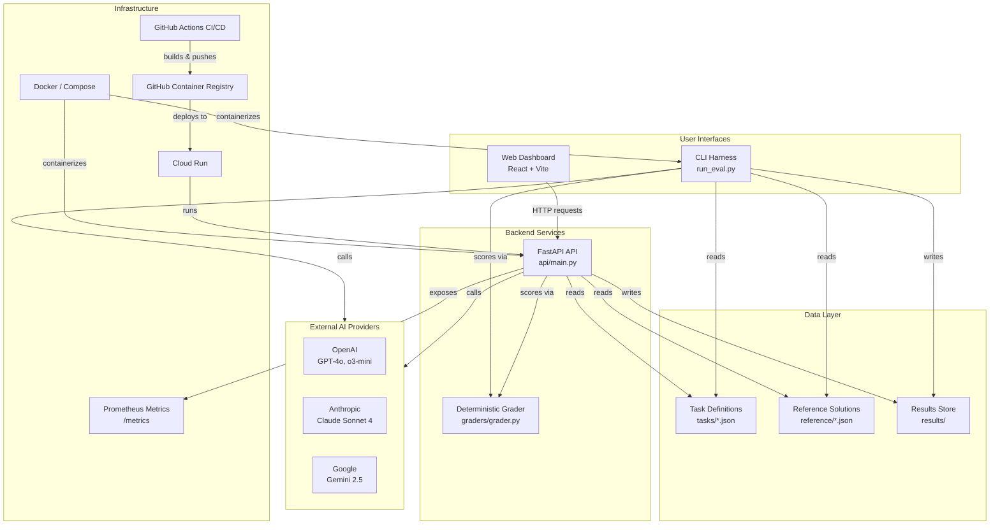
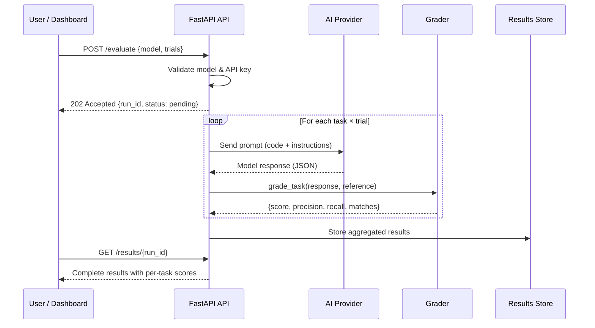

# ConcurrencyBugBench — Architecture

## Project Overview

ConcurrencyBugBench is an end-to-end evaluation platform for measuring how well AI models detect concurrency bugs in Python code. The system comprises four layers: a **CLI evaluation harness**, a **REST API**, a **web dashboard**, and a **CI/CD + deployment pipeline** — all containerized with Docker and monitored via Prometheus metrics.

The benchmark includes 7 hand-crafted tasks containing 22 documented concurrency defects (race conditions, deadlocks, atomicity violations, etc.). A fully deterministic grader scores model responses against reference solutions without using an LLM judge.

## Architecture Diagram

## Component Descriptions

### CLI Evaluation Harness (`run_eval.py`)

The primary entry point for running benchmarks. It iterates over tasks, calls AI provider APIs, grades responses, and writes structured results (JSON + text summaries). Supports `--model`, `--trials`, `--dry-run`, and `--validate-grader` flags.

### FastAPI REST API (`api/main.py`)

A production-grade REST API that exposes the benchmark as a service:

| Endpoint               | Method | Description                               |
|------------------------|--------|-------------------------------------------|
| `/health`              | GET    | Service health and available models       |
| `/tasks`               | GET    | List all benchmark tasks                  |
| `/tasks/{task_id}`     | GET    | Get a single task's details               |
| `/evaluate`            | POST   | Start a background evaluation run         |
| `/results`             | GET    | List all completed runs                   |
| `/results/{run_id}`    | GET    | Detailed results for a specific run       |
| `/metrics`             | GET    | Prometheus metrics endpoint               |
| `/docs`                | GET    | Interactive Swagger UI documentation      |

**Key features**: API-key authentication, rate limiting (SlowAPI), structured logging (structlog), Prometheus instrumentation, CORS support, background task execution.

### Deterministic Grader (`graders/grader.py`)

Scores model responses against reference solutions using a three-step algorithm:

1. **Function match** — normalize and compare the target function name
2. **Bug type match** — classify using a synonym table (e.g., `data_race` → `race_condition`)
3. **Explanation quality** — regex-based concept matching against curated key terms

Outputs precision, recall, and F1 for each task. No LLM judge is involved.

### Web Dashboard (`frontend/`)

A React + Vite single-page application that provides:

- Task browser with difficulty indicators
- Evaluation trigger with model selection
- Real-time results display with per-task score breakdowns
- Visual charts for precision/recall/F1 comparisons

### Docker & Compose

Two Dockerfiles provide isolated, reproducible environments:

| Image         | Dockerfile       | Purpose                        |
|---------------|------------------|--------------------------------|
| `benchmark`   | `Dockerfile`     | CLI harness for batch runs     |
| `api`         | `Dockerfile.api` | FastAPI server (port 8000)     |

`docker-compose.yml` orchestrates both services with shared volumes for results, tasks, and references.

### CI/CD Pipeline (`.github/workflows/ci.yml`)

A three-stage GitHub Actions pipeline:

1. **`lint-and-test`** — Runs Black, isort, Ruff, MyPy, and pytest with coverage
2. **`docker-build`** — Validates that both Docker images build successfully
3. **`publish-images`** — On version tag push (`v*`), builds and pushes images to GitHub Container Registry

### Cloud Run Deployment (`deploy/`)

Production deployment to Google Cloud Run with:

- Autoscaling (0–5 instances)
- Secrets from GCP Secret Manager
- Health and liveness probes
- CPU boost on startup

## Data Flow

## Technology Stack

| Layer           | Technology                     | Purpose                                    |
|-----------------|--------------------------------|--------------------------------------------|
| Language        | Python 3.11                    | Core runtime                               |
| API Framework   | FastAPI + Uvicorn              | Async REST API with auto-generated docs    |
| Frontend        | React 18 + Vite                | Interactive web dashboard                  |
| Auth            | API key header (`X-API-Key`)   | Write-endpoint protection                  |
| Rate Limiting   | SlowAPI                        | Request throttling                         |
| Monitoring      | prometheus-fastapi-instrumentator | Request metrics and latency tracking    |
| Logging         | structlog                      | Structured JSON logging                    |
| Containerization| Docker + Docker Compose        | Reproducible builds and orchestration      |
| CI/CD           | GitHub Actions                 | Lint, test, build, and publish pipeline    |
| Registry        | GitHub Container Registry      | Docker image hosting                       |
| Deployment      | Google Cloud Run               | Serverless production hosting              |
| Linting         | Black, isort, Ruff, MyPy       | Code quality and type checking             |
| Testing         | pytest + pytest-cov            | Unit tests with coverage reporting         |
| AI Providers    | OpenAI, Anthropic, Google      | Model inference for benchmarking           |
